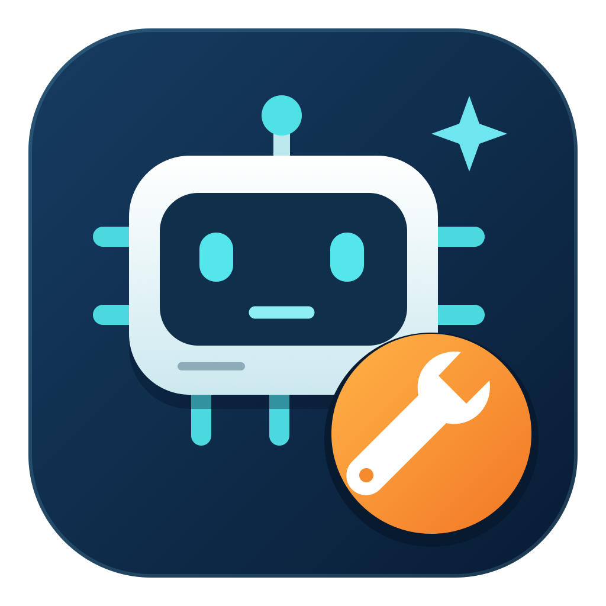

# Agent Maintenance

Version **0.1.4**. A standalone Python CLI and native macOS app for maintaining Codex, local ChatGPT Work, and Claude Code conversation files on this computer or SSH hosts.



## Features

- Inspect conversation stores, storage categories, projects, archives, and subagent relationships.
- Filter Codex, local ChatGPT Work, and Claude separately. Desktop project assignments keep Codex and Work conversations together, including projects with multiple folders.
- Back up a project or selected conversations, including original transcripts, associated media, readable exports, and per-conversation database row exports.
- Archive, restore archived conversations, or delete selected conversations after reviewing the target and scope. Backups are managed separately.
- Preview and clean eligible logs and temporary files.
- Check or upgrade Codex and Claude CLIs on selected hosts using their native updaters, with live command output.
- View live operation output and timestamped results in the app. Completed summaries can be cleared; the separate Remote CLI log is temporary.

Codex and local Work archive, unarchive, and delete use native Codex CLI commands. **Claude File archive** moves session files to `~/.claude-archive`; restoring moves them back. It does not call Claude Desktop's Archive. Restoring a backup extracts standalone files; automatic import into a native app sidebar is not implemented. Codex desktop's QR-paired Remote transport is not integrated. See [the CLI reference](README.txt) for operation details and boundaries.

Local Work records are identified by the desktop's `codex_work_desktop` originator marker in the shared Codex store. Descendants inherit their main conversation's source and project. This scanner covers local Work files; cloud Work history is outside its scope. Use `--surface chatgpt-work` for Work alone, `--surface codex` for Codex alone, or the default `--surface all` for a mixed project. The compatibility option `--tool codex` selects the shared storage backend and includes both sources.

## Requirements

- Python 3.9+ on the computer running the CLI and each SSH target; no third-party Python packages are required.
- OpenSSH with working literal aliases and noninteractive authentication for SSH targets.
- macOS 14+ for the native app, supporting Intel and Apple Silicon. The CLI also runs on Linux.
- Codex CLI on the host storing conversations for native Codex and local Work mutations. Scanning and backups work without agent CLIs. A controlling Mac does not need locally installed agent CLIs to manage a remote host.

The tool reads local conversation files and runs commands through existing SSH configuration. It installs no remote daemon and does not monitor network traffic. `config.example.json` contains placeholder aliases; keep live aliases, credentials, and conversation backups outside the repository.

## Install the CLI

From this repository's root:

```bash
python3 packages/agent-maintenance/install.py
~/.local/bin/agent-maintenance --version
~/.local/bin/agent-maintenance hosts --json
~/.local/bin/agent-maintenance sessions --host local
~/.local/bin/agent-maintenance sessions --host local --surface chatgpt-work
```

Discover aliases from `~/.ssh/config`, or select your own aliases:

```bash
~/.local/bin/agent-maintenance config --hosts my-server,another-server
~/.local/bin/agent-maintenance config --upgrade-hosts my-server,another-server
~/.local/bin/agent-maintenance upgrade --progress
```

Checks do not apply upgrades. Add `--apply` to explicitly run native updates. Example request: `Inspect my-server's Codex sessions, back up the selected project, and show a cleanup preview.`

## Install the macOS app

Open [Agent Maintenance compatibility builds](https://github.com/zhaoshuoxp/agent-tools/actions/workflows/agent-maintenance.yml), choose a successful run, and download the **AgentMaintenance-macOS** artifact. Extract its `AgentMaintenance-Test-0.1.4-macOS.zip`, quit older app copies, and run the included `Install.command`.

The installer creates `~/Applications/Agent Maintenance.app` and `~/.local/bin/agent-maintenance`, retaining previous program installations. The test app is ad-hoc signed and not notarized. Python is discovered from supported system or user installations and is not bundled. See [distribution instructions](DISTRIBUTION.txt).

## Build and test

From the repository root:

```bash
python3 -m unittest discover -s packages/agent-maintenance -p test_maintenance.py -v
```

Build the universal app and distribution on macOS with a compatible SDK or complete Xcode installation:

```bash
cd packages/agent-maintenance
AGENT_BUILD_DIR="$(mktemp -d "${TMPDIR:-/tmp/}agent-maintenance-build.XXXXXX")"
desktop/build-app.sh "$AGENT_BUILD_DIR/app"
python3 desktop/verify-app.py "$AGENT_BUILD_DIR/app/Agent Maintenance.app"
python3 package-distribution.py "$AGENT_BUILD_DIR/app/AgentMaintenance-macOS.zip" "$AGENT_BUILD_DIR/distribution"
```

Set `AGENT_MAINTENANCE_SDK_PATH` when selecting a specific compatible macOS SDK. The GitHub workflow tests Python 3.9 and 3.13, builds both Mac architectures, checks Work source filtering, live output, and operation-history save/clear behavior, and smoke-tests installation in temporary directories. Tests use synthetic stores. `validate_native_codex.py` separately exercises native archive/unarchive/delete for Codex and Work records in isolated homes without model calls.

Visual button interaction still requires manual acceptance on a test Mac.

## Update and remove

Run `git pull --ff-only` in the repository, then repeat the CLI installer or install the latest successful macOS build. The shared ChatGPT plugin marketplace manages the other packages; this tool uses its own CLI and desktop installer.

To remove the program, remove its launcher at `~/.local/bin/agent-maintenance` and its installed program directory: `~/Library/Application Support/AgentMaintenance/CLI` on macOS or `~/.local/share/agent-maintenance` on Linux. The desktop app is at `~/Applications/Agent Maintenance.app`. Conversation stores and user-selected backup files are managed separately. The app's **Clear records** button clears its saved operation history.

## Source and license

Imported from [`zhaoshuoxp/agent-speed`](https://github.com/zhaoshuoxp/agent-speed/tree/9809c30c88aec68e55523b7e80f3b2a11e7a0963/tools/agent-maintenance). [IMPORT.json](IMPORT.json) records the original commit and repository adaptations. The original [MIT license](LICENSE) is retained.
